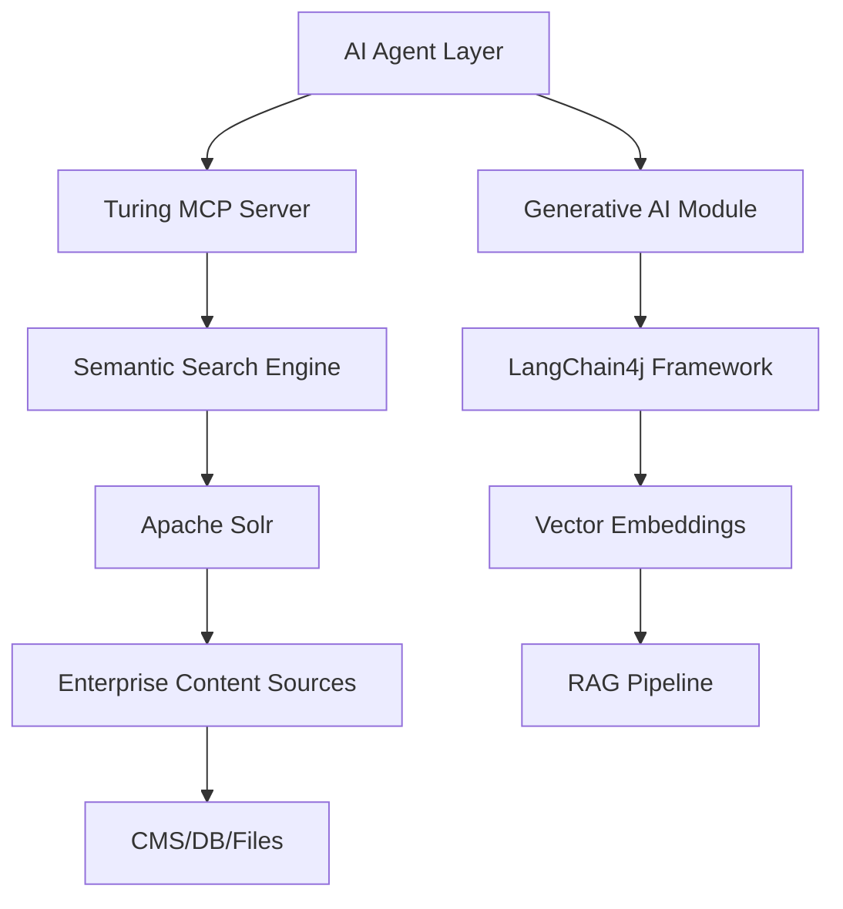

# Turing: Enterprise Search Intelligence Platform

## Development Guidelines

### Project Structure

- **turing-app**: Spring Boot 4 backend (Java 21), main Maven module
- **frontend/**: pnpm + Turborepo monorepo with the React apps and SDK packages
  - **frontend/apps/turing-app**: React 19 + TypeScript frontend (Vite, Tailwind v4, shadcn/ui)
  - **frontend/apps/marketplace**: marketplace example apps (mythical-creatures, space-missions, vinyl-records)
  - **frontend/packages/react-sdk**: `@viglet/turing-react-sdk` — hooks and UI components for the Turing API
  - **frontend/packages/shared-types**: `@viglet/turing-shared-types`
- **turing-commons**, **turing-spring**, **turing-java-sdk**: shared libraries
- Root Maven POM is multi-module
- The legacy `turing-react/` directory is a stub (only contains `node/`); it has been migrated to the monorepo above

### Key Paths

- Backend source: `turing-app/src/main/java/com/viglet/turing/`
- Backend tests: `turing-app/src/test/java/com/viglet/turing/`
- Frontend source: `frontend/apps/turing-app/src/`
- Frontend route definitions: `frontend/apps/turing-app/src/app/routes/` (all use `React.lazy()` since 2026.2.6)
- Frontend query hooks: `frontend/apps/turing-app/src/api/queries/` (React Query v5)
- Liquibase changelogs: `turing-app/src/main/resources/db/changelog/`

### Build & Test Commands

```bash
# Backend tests only (skip frontend npm build)
mvn test -pl turing-app -Dskip.npm=true

# Run specific test class
mvn test -pl turing-app -Dskip.npm=true -Dtest="ClassName"

# Backend integration tests (requires Docker — uses Testcontainers)
mvn verify -pl turing-app -Dskip.npm=true

# Frontend compile (from frontend/apps/turing-app)
pnpm run build           # tsc -b && vite build
pnpm exec tsc -b --noEmit  # type-check only, no emit
pnpm dev                 # local dev server

# Full Maven build
mvn clean install

# Design system iteration: copy-ds.cmd at repo root (rebuilds + copies viglet-design-system dist)
```

> **Windows PowerShell**: quote `-D` flags, e.g. `"-Dskip.npm=true"`

### Backend Conventions

- **Spring Boot 4** with **Spring AI 2.0.0-M2** for LLM integration
- Persistence: JPA/Hibernate with H2 (dev) and Liquibase migrations
- REST controllers in `api/` package, services in dedicated packages
- Use constructor injection (no `@Autowired` on fields)
- Records for DTOs/API request-response types
- Avoid injecting `ObjectMapper` in controllers — use `@RequestBody` / `@RequestPart` for auto-deserialization
- `TurSecretCryptoService` handles API key encryption/decryption

### File Header Convention

- **Every new Java file** must include a `@since` tag in the class-level Javadoc with the current project version (check the `<version>` in the root `pom.xml`)
- Current version: **2026.2.4**
- Example:
  ```java
  /**
   * Description of the class.
   *
   * @author Alexandre Oliveira
   * @since 2026.2.4
   */
  ```
- When the project version changes, update the "Current version" line above so new files always reference the correct version

### JPA & Database Column Naming

- **No implicit naming strategy** is configured — Hibernate maps Java field names **literally** to column names (no snake_case conversion)
- A Java field `sitePrompt` maps to column `sitePrompt`, **not** `site_prompt`
- When adding `@Column` annotations, use the exact camelCase field name (or omit `name` to let Hibernate use the default)
- **Never use snake_case** in Liquibase column names unless the existing table already uses it — always match the convention of the target table
- Existing tables like `sn_site_genai` use camelCase columns: `systemPrompt`, `sitePrompt`
- Existing tables like `sn_site` use lowercase: `description`, `name`, `facet`
- When in doubt, check the existing columns in the entity class or run a query against the H2 dev database

### Liquibase Conventions

- **Always create a new file** — never modify existing changelog files
- Naming: `v{currentVersion}.{subversion}.yaml` with incremental subversion (e.g., if current version is `2026.1.14` and `v2026.1.14.0.yaml` exists, the next file is `v2026.1.14.1.yaml`)
- Include in `db.changelog-master.yaml`
- Use `preconditions` with `onFail: MARK_RAN` for idempotent changesets
- Column size changes: use `modifyDataType`; new data: use `insert`
- **Column names must match the JPA field name exactly** (camelCase) — see "JPA & Database Column Naming" above
- **Large text columns**: use `longtext` instead of `clob` — `longtext` is compatible with H2, MySQL, and PostgreSQL, while `clob` may not map correctly on MySQL

### Visual Identity & Brand Colors

- **Product name**: Viglet Turing ES (Enterprise Search)
- **Logo**: `turing-react/public/favicon-96x96.png` (also available at 32x32, 16x16)
- **Primary gradient**: `blue-600 (#2563eb)` → `indigo-600 (#4f46e5)` — used in buttons, avatars, switches, headers
- **Dark mode primary**: `blue-500 (#3b82f6)` → `indigo-500 (#6366f1)`
- **Semantic colors**:
  - Success: `emerald-600 (#059669)` → `teal-600 (#0d9488)`
  - Destructive: `red-600 (#dc2626)` → `rose-600 (#e11d48)`
  - Secondary: `slate-600 (#475569)` → `slate-700 (#334155)`
- **Gradient components**: `GradientButton`, `GradientAvatar`, `GradientSwitch` — all use the blue→indigo gradient
- **Email templates**: use inline styles with the same blue→indigo palette; dark background `#0a0a0f`, card background `#16161f`, border `#1e1e2e`
- **Icons**: `@tabler/icons-react` (primary), `lucide-react` (some components)
- Always reference the product as **Viglet Turing ES** in user-facing text (emails, reports, footers)

### Frontend Conventions

- **React 19** + **TypeScript** + **Vite**
- **Tailwind CSS v4** with `@tailwindcss/typography` plugin
- **shadcn/ui** components in `src/components/ui/`
- Custom gradient components: `GradientButton`, `GradientAvatar`, `GradientSwitch`
- Icons: `@tabler/icons-react` (primary), `lucide-react` (some components)
- Routing: `react-router-dom` with routes defined in `src/app/routes/`. **All route files use `React.lazy()`** — when adding a new route, follow the pattern (`const FooPage = lazy(() => import("..."))`) so the new bundle is code-split automatically
- Services: class-based in `src/services/`, use `axios` for REST, native `fetch` for SSE streaming
- Models: TypeScript interfaces in `src/models/`
- CSRF: For non-axios requests, read `XSRF-TOKEN` cookie or fetch from `/csrf` endpoint

#### Data fetching with React Query (since 2026.2.6)

Read paths use **`@tanstack/react-query` v5**. Don't reach for `useState` + `useEffect` + `axios.then()` — that pattern is being phased out.

- **Singleton client** in `src/lib/query-client.ts` — defaults: 30s staleTime, 5min gcTime, 1 retry, no refetch-on-window-focus.
- **Query hooks** live in `src/api/queries/{feature}.queries.ts` and wrap a service:
  ```ts
  // src/api/queries/foo.queries.ts
  const service = new TurFooService();
  export function useFoos() {
    return useQuery({ queryKey: queryKeys.foos.list(), queryFn: () => service.query() });
  }
  // For entity-scoped lists:
  export function useFoos(parentId: string | undefined) {
    return useQuery({
      queryKey: parentId ? queryKeys.foos.listByParent(parentId) : ['foos', 'pending'],
      queryFn: () => service.query(parentId as string),
      enabled: Boolean(parentId),
    });
  }
  ```
- **Query keys** are centralised in `src/api/queries/keys.ts` so mutations can invalidate them deterministically. Always extend `queryKeys` rather than inlining string arrays.
- **Dependent query** (e.g. Keycloak vs JPA backend in admin pages): pass the discriminator as a parameter, set `enabled: discriminator !== null`, and split the query key by source so toggling invalidates cleanly. See `src/api/queries/admin.queries.ts` for the canonical example.
- **Mutations** (when adding new write paths): use `useMutation` and call `queryClient.invalidateQueries({ queryKey: queryKeys.foos.all() })` in the `onSuccess` handler so cached lists refresh automatically.
- **Page pattern** — replace the legacy `useState`/`useEffect` block with one line:
  ```ts
  const { data: foos, isError } = useFoos();
  const error = isError ? t("common.connectionError", { resource: "foos" }) : null;
  ```

### Testing Conventions

- Backend: JUnit 5 + Mockito with `@ExtendWith(MockitoExtension.class)`
- Mockito strict stubbing: stub all methods that will be called (use `any()` for broad matching)
- Integration tests use `@SpringBootTest` with full context — keep controllers lean to avoid bean issues
- Always run `mvn test -pl turing-app -Dskip.npm=true` after backend changes

#### Integration test (`*IT.java`) `@SpringBootTest` requirements

Every new IT that boots the full Spring context **must** either:

1. **Extend `AbstractTuringSpringIT`** ([turing-app/src/test/java/com/viglet/turing/testutil/AbstractTuringSpringIT.java](turing-app/src/test/java/com/viglet/turing/testutil/AbstractTuringSpringIT.java)) — gives you an ephemeral H2 datasource, snapshot seeding, JMX enabled, **per-JVM Artemis data directory**, and proper cleanup. **Preferred**. The subclass **must NOT redeclare `@SpringBootTest`** — that would override (not merge with) the parent's annotation and silently drop `spring.jmx.enabled=true`:

   ```java
   // ✅ correct — inherits @SpringBootTest from AbstractTuringSpringIT
   class TurFooIT extends AbstractTuringSpringIT {
       @Test
       void something() { ... }
   }

   // ❌ wrong — own @SpringBootTest overrides parent's annotation,
   //    JMX property is lost, context fails on TurQueueBrowserService
   @SpringBootTest
   class TurFooIT extends AbstractTuringSpringIT { ... }
   ```

2. **Or, when subclassing isn't possible** (rare — e.g. needs a different base or test slice), explicitly enable JMX on the annotation:

   ```java
   @SpringBootTest(properties = "spring.jmx.enabled=true")
   class TurFooIT { ... }
   ```

   When going this route, also override `spring.artemis.embedded.data-directory` via `@DynamicPropertySource` to a unique per-JVM path (see `AbstractTuringSpringIT.overrideArtemisDataDirectoryWithEphemeralPath`), otherwise concurrent ITs and a locally-running app will collide on the same Artemis file lock and hang for several minutes on context startup.

**Why JMX must be passed via `properties = ...`**: `TurQueueBrowserService` injects `javax.management.MBeanServer` in its constructor (mandatory dep, not optional). In Spring Boot 4, the `JmxAutoConfiguration` that supplies `MBeanServer` is **not** activated in `@SpringBootTest` from `application.yaml` alone — the property has to be passed via `properties = ...` on the annotation. Without it the context fails with `No qualifying bean of type 'javax.management.MBeanServer' available` and Failsafe burns ~30s per attempt before giving up.

**Why per-JVM Artemis data dir matters**: the production default is `spring.artemis.embedded.data-directory=store/queue` — a CWD-relative path. With embedded Artemis + `persistent: true`, two JVMs sharing that path (e.g. a running app + a forked Surefire IT, or two parallel ITs) compete for `server.lock` and serialize through `FileLockNodeManager`'s sleep-retry loop. Symptom: the IT hangs on Spring context startup with no error logged, until you `Stop-Process` the other JVM. `AbstractTuringSpringIT` redirects this to a unique per-JVM temp dir, eliminating the class of bug entirely.

#### JPA fetch strategy: LAZY by default

**Always use `FetchType.LAZY` for associations.** This is a project-wide rule, not a per-case decision.

- `@OneToOne`: JPA default is EAGER → **must** override with `@OneToOne(fetch = FetchType.LAZY)`.
- `@ManyToOne`: JPA default is EAGER → **must** override with `@ManyToOne(fetch = FetchType.LAZY)`.
- `@OneToMany`, `@ManyToMany`: default is LAZY — leave it.
- **Never use `FetchType.EAGER`** unless you have a measured, documented reason. Add a `// reason:` comment when you do.

**Why this is non-negotiable**: EAGER associations cascade across the object graph and explode load cost. Real incident — search latency went from **200ms → 5s** on sites with an AI Agent configured because `TurSNSite → TurSNSiteGenAi → TurAIAgent → 4 @ManyToMany` all defaulted to EAGER, even though search never touches GenAi. Reverting that one chain to LAZY brought search back to ~200ms.

**Safety net for legacy code paths**: [turing-app/src/main/resources/application.yaml](turing-app/src/main/resources/application.yaml) has `hibernate.enable_lazy_load_no_trans=true`, so LAZY access outside a `@Transactional` boundary still works (Hibernate opens a temporary session). This is a fallback for callers we may have missed during the EAGER → LAZY migration — **don't rely on it for new code**. New write paths and chat/RAG flows should access lazy associations inside an `@Transactional` or service-managed session.

**When loading a graph in one shot is genuinely needed**, use:
- `@EntityGraph(attributePaths = {...})` on the repository method, or
- `JOIN FETCH` in a `@Query`

— not `FetchType.EAGER` on the entity.

#### Other testing rules

- Always check `application.yaml` defaults before writing test-specific properties — most ITs should inherit project conventions.

### Common Pitfalls

- `@Column(length=N)` must accommodate all enum/ID values (e.g., "AZURE_OPENAI" = 12 chars)
- **MySQL primary key limit**: Max key length is 3072 bytes. With `utf8mb4` (4 bytes/char), `VARCHAR` PKs must be ≤ 768 chars. Example: `VARCHAR(1024)` PK fails on MySQL — use `VARCHAR(768)` instead
- Spring AI 1.1.2: `AzureOpenAiEmbeddingModel` has no builder — use constructor
- Anthropic and Gemini providers don't support embedding — throw `UnsupportedOperationException`
- Frontend npm builds may fail with EBUSY on Windows if IDE locks files — use `-Dskip.npm=true` for backend-only testing

### Pluggable Storage Architecture

The storage layer is abstracted via `TurStorageService` interface with three implementations:

**Configuration** (`application.yaml`):

```yaml
turing:
  storage:
    type: none # none | minio | filesystem
    filesystem:
      path: ./store/assets
    minio:
      endpoint: http://localhost:9000
      access-key: admin
      secret-key: minha_senha_forte
      bucket: turing-assets
```

**Key classes** (all in `service/storage/`):

- `TurStorageType` — enum: `NONE`, `MINIO`, `FILESYSTEM`
- `TurStorageService` — interface: `isEnabled()`, `getType()`, `listObjects()`, `downloadObject()`, `statObject()`, `uploadObject()`, `uploadStream()`, `deleteObject()`, `deleteObjectsWithPrefix()`, `createFolder()`, `guessContentType()`
- `TurStorageObjectStat` — neutral DTO replacing MinIO's `StatObjectResponse`
- `TurStorageContentTypes` — shared static MIME type utility
- `TurMinioStorageService` — MinIO implementation
- `TurFilesystemStorageService` — filesystem implementation with path traversal protection (`resolveSafe()`)
- `TurNoOpStorageService` — disabled/no-op implementation (lists return empty, mutations throw)
- `TurStorageConfig` — `@Configuration` with `@Bean` factory that selects implementation based on `turing.storage.type`

**Properties** (in `properties/`):

- `TurStorageProperty` — `type` (enum), nested `minio` (TurMinioProperty), nested `filesystem` (TurFilesystemProperty with `path`)
- `TurMinioProperty` — `endpoint`, `accessKey`, `secretKey`, `bucket` (no `enabled` field — type selection controls this)
- Access pattern: `configProperties.getStorage().getMinio()` or `configProperties.getStorage().getFilesystem().getPath()`
- Old `turing.minio.enabled` and `turing.minio.*` are **removed** — all storage config lives under `turing.storage.*`

**Frontend feature flag**: `FeaturesResponse.storageEnabled` (renamed from `minioEnabled`)

- Sidebar hides "assets" and "pages" when `storageEnabled=false`
- System Info shows storage section with dynamic type label and property key

### LLM Summary Service (Cached AI Insights)

Reusable service for generating cached LLM summaries with regenerate support:

**Backend** (`system/TurLlmSummaryService`):

- `generate(cacheKey, data, systemPrompt, regenerate)` → `SummaryResult(success, error, content, canRegenerate)`
- Uses `TurLlmCacheService` for in-memory caching (respects Global Settings TTL)
- Uses default LLM from `TurGlobalSettingsService.getDefaultLlmId()`
- `isAvailable()` — checks if default LLM is configured and enabled

**Used by**:

- `TurSNSiteSummaryAPI` — `GET /api/sn/{id}/summary?regenerate=false` for SN site insights
- `TurSystemInfoAPI` — `GET /api/system/info/insights?regenerate=false` for system info AI insights
- Both follow same pattern: collect data → call `llmSummaryService.generate()` → return `SummaryResult`

**Frontend pattern** (same for both SN insights and System Info insights):

```typescript
const response = await axios.get<InsightsResponse>(url, {
  params: regenerate ? { regenerate: true } : {},
});
// InsightsResponse: { success, error, content, canRegenerate }
```

- Show regenerate button when `canRegenerate=true` (controlled by `llmCacheRegenerate` in Global Settings)
- System Info uses a resizable side panel; SN insights uses a full page

### ResizablePanel Customization (shadcn)

The `ResizablePanel` component (`components/ui/resizable.tsx`) has a custom `overflowHidden` prop:

- `react-resizable-panels` injects an internal wrapper `div` with `style="overflow: auto"` that cannot be controlled via props
- `overflowHidden` prop applies `overflow: hidden` on the Panel element and `[&>div]:overflow-hidden!` (with `!important`) to override the inline style on the internal wrapper
- Use `<ResizablePanel overflowHidden>` when the panel content manages its own scroll (e.g., a Card with `overflow-auto` on its body)

### Agent Operational Memory (Repository)

- In `react-hook-form`, `disabled` fields are omitted from submission payloads; use `readOnly` when a value must be non-editable but still sent.
- `TurAuthenticationEntryPoint` tests should validate `commence(...)` output directly: HTTP 401, `application/json`, and `{"error":"Unauthorized"}`.
- For custom `/api/login` session auth alongside `httpBasic`, explicitly use `HttpSessionSecurityContextRepository` with `SessionCreationPolicy.IF_REQUIRED` to avoid browser requests returning 401 with valid `JSESSIONID`.
- In SN field-check flows, `TurSolrFieldBean.getType()` may be `null`; prefer `Objects.equals(actual, expected)` over calling `.equals()` on nullable values.
- For write-only secret fields modeled as JPA `@Transient` (`apiKey`, `credential`), MockMvc/Jackson binding may skip values; extract secrets from raw request payload map in controller tests and runtime paths.
- Liquibase updates on reused local H2 files can fail with `Duplicate column name`; make changeSets idempotent with `preConditions` (`columnExists` + `onFail: MARK_RAN`).
- In PowerShell, quote Maven test filters like `"-Dtest=A,B"` to avoid comma parsing issues.
- In JUnit `@CsvSource`, quote regex values containing commas (for example `'1[.,]5B'`) and use `nullValues = "null"` when a true `null` is required.
- In this Windows workspace, `py` may be unavailable; prefer `python` (for example `python -m py_compile ...`).
- If `rg` is unavailable in PowerShell, use `Get-ChildItem` + `Select-String` for scripted searches.
- **Multi-valued fields that become facets must be `multiValued`.** A field carrying several values per document (e.g. `endOfClasses` — one date per EE offering) that is NOT marked `multiValued` is **concatenated** by `TurSolrDocumentHandler.processArrayList`/`processJSONArray` via `concatenateString` (`System.lineSeparator()`). For a Solr `date` field this produces an unparseable value and Solr aborts the whole document with `Invalid Date Math String`. Fix: set `multiValued=1` on the field (`TurSNSiteFieldExt`/`TurSNSiteField`) — then the handler indexes each value separately and `TurSolrUtils.addOrUpdateField` creates the Solr field as `multiValued`. If the Solr field already exists as single-valued, the symptom flips to `multiple values encountered for non multiValued field` — `TurSNProcessQueue.createMissingFields` now self-heals this via `plugin.reconcileMultiValued` → `TurSolrUtils.reconcileMultiValued`, which makes the Solr field multiValued **preserving its current type** (once per site:field per JVM). **Never change a field's TYPE on an index with documents** — flipping a points type (e.g. `pdouble`→`pfloat`) throws `cannot change field ... numBytes=8 to ... numBytes=4` and only a clean reindex fixes it (this bit us when the reconciler initially passed Turing's type into the REPLACE). Manual fallback: `TurSNSiteFieldRepairAPI` (`POST /api/sn/{siteId}/field/repair`; `SE_ENABLE_MULTI_VALUE` preserves type, `SE_CHANGE_TYPE`/`REPAIR_ALL` may change it). Single→multi is a metadata change; reindex to backfill old docs. `TurSNProcessQueue.promoteMultiValuedFromPayload` also AUTO-promotes a field to multiValued when a document carries multiple values for a **non-concatenable type** (DATE/INT/LONG/FLOAT/DOUBLE/BOOL/CURRENCY) still flagged single — concatenating those breaks Solr (`Invalid Date Math String` / number-format). STRING/TEXT/ARRAY are left alone.
- **A bad document must not stall the JMS indexing queue.** `TurSolrDocumentHandler.addSolrDocument` catches broadly (`catch (Exception)`) — `RemoteSolrException` is a `RuntimeException`, so a narrow `catch (SolrServerException | IOException)` lets it escape, propagate to the JMS listener, and cause endless re-delivery (retries every ~0.5s) that jams indexing and can trip the Solr CircuitBreaker.
- **Jackson 3 (`tools.jackson`, Spring Boot 4) defaults `FAIL_ON_NULL_FOR_PRIMITIVES=true`** (Jackson 2 was `false`). A `record` used as `@RequestBody` with **primitive** components (`boolean`/`int`) fails with `MismatchedInputException` → 400 "Request body is missing or malformed" when the client omits those fields. Keep request records free of primitives (use a request-only record with object types, separate from the response DTO), e.g. `TurSNSiteFacetProfileRequest(String name, String description)`.
- **Stale incremental-compile cache on Windows produces phantom errors.** Transient `cannot find symbol: class TurSNSite` in a file you never touched, or `incompatible types: X cannot be converted to X` (same simple name, seemingly different packages), from the `maven-compiler-plugin` are almost always a stale incremental-compilation cache — not real code errors. Re-run with `clean` (`.\mvnw.cmd -pl turing-app -Dskip.npm=true clean ... test`) and they vanish. Don't chase them as source bugs.
- **Rebuild `turing-commons` with `-am` when it changed.** `-pl turing-app` alone (especially with `clean`) resolves `turing-commons` from `.m2`, so a stale artifact yields errors like `cannot find symbol: method getProfile()` on `TurSEParameters` even though the source is correct. Always pass `-am` (`.\mvnw.cmd -pl turing-app -am ...`) after touching `turing-commons`. And for a filtered run (`-Dtest=...`) with `-am`, add `-Dsurefire.failIfNoSpecifiedTests=false` so sibling modules with no matching test don't fail the build.
- **To cache a repository read whose entity has a LAZY relation you navigate, cache a `JOIN FETCH` query — not the plain finder.** A `@Cacheable` finder returns a detached entity on a cache hit; touching its LAZY collection then throws `LazyInitializationException`. Add a dedicated `@Cacheable @Query("SELECT DISTINCT e ... LEFT JOIN FETCH e.items ...")` (eagerly loads the collection) and use it on the hot/runtime path — e.g. `TurProfileFacetOrderingRepository.findByTurProfileAndTurSNSiteWithItems` (used by `TurSNFieldProcess` on every search). Keep the plain (uncached) finder for transactional console paths. Reading `getId()` on a LAZY `@ManyToOne` proxy is fine even detached (no query), so only collections need the fetch.
- **Never navigate a LAZY relation on an entity returned by a `@Cacheable` repository.** Cached reads (e.g. `TurSNSiteFieldExtRepository.findByTurSNSiteAndEnabled`) return **detached** entities, so `fieldExt.getCustomFacets()` throws `LazyInitializationException: Cannot lazily initialize collection`. Load the related rows with an explicit fetch query instead — `TurSNSiteCustomFacetRepository.findByFieldExtsWithDetails(fields)` (the pattern used by `TurSNFacetDefinitionFactory`) — and save children directly via that repo, not by cascading through the detached parent. This bit `TurSNSiteFacetProfileService.seedDefaultProfile`/`persistOrdering` (facet reorder save).

- **Editing `@viglet/turing-react-sdk` requires rebuilding its `dist`.** The app consumes the SDK package via `main`/`types` → `dist/` (no Vite/tsconfig alias to `packages/react-sdk/src`). After changing `packages/react-sdk/src/**`, rebuild before the app sees it (runtime *and* type-check): `cd frontend/packages/react-sdk && node node_modules/typescript/lib/tsc.js`. The SDK's search request params are a **fixed allowlist** in `core/api.ts` `buildQueryString` (q, p, _setlocale, sort, fq[], tr[], nfpr, group, rows, facetProfile) — a URL param not in that list is silently dropped. To add a new search param, extend `SearchParams` + `buildQueryString` + the URL round-trip (`provider.tsx` `urlToSearchParams`/`searchParamsToUrl`, `api.ts` `parseHrefToParams`).

### Frontend TypeScript Check (Windows EBUSY workaround)

When `node_modules` native binaries are locked by the IDE/Vite dev server:

1. **Don't loop** retrying `npm ci`, `npm install`, `npx tsc`, or other install variations — they will all fail with EBUSY/EPERM while the IDE holds locks.
2. **Rely on IDE diagnostics** from VSCode hook feedback (`ide_diagnostics` in tool responses) — these provide real-time TypeScript error checking without needing `tsc`.
3. **Backend compile is the primary gate** — run `mvn compile -pl turing-app -Dskip.npm=true` to verify Java code.
4. **Isolated temp build** (only if IDE diagnostics are unavailable):

```bash
BUILD_DIR="$TEMP/turing_react_build_$(date +%s)"
mkdir -p "$BUILD_DIR"
cp -r turing-react/src turing-react/package.json turing-react/package-lock.json \
      turing-react/tsconfig.json turing-react/tsconfig.app.json \
      turing-react/tsconfig.node.json turing-react/vite.config.ts \
      turing-react/index.html "$BUILD_DIR/"
cd "$BUILD_DIR"
npm install --no-audit --no-fund
node node_modules/typescript/lib/tsc --noEmit -p tsconfig.app.json
rm -rf "$BUILD_DIR"
```

- Use `tsconfig.app.json` (not `tsconfig.json`) — the root tsconfig uses project references and `bundler` resolution that requires the full toolchain.
- Do **not** use `npx tsc` or `./node_modules/.bin/tsc` — these may fail on Windows bash. Use `node node_modules/typescript/lib/tsc` directly.

---

## Overview

Viglet Turing is a comprehensive **Enterprise Search Intelligence Platform** that serves as an ideal foundation for AI agent systems focused on enterprise search and knowledge discovery. By combining semantic navigation, generative AI capabilities, and advanced search technologies, Turing provides the infrastructure needed for intelligent agents to interact with and understand enterprise content at scale.

## Why Turing for AI Agent Research?

### 1. **Semantic Understanding Foundation**

- **Semantic Navigation**: Advanced content understanding beyond keyword matching
- **Contextual Search**: AI agents can leverage contextual relationships between documents
- **Multi-language Support**: Global enterprise content accessibility
- **Intelligent Indexing**: Automatic content classification and relationship mapping

### 2. **Generative AI Integration**

- **LangChain4j Integration**: Built-in support for modern AI frameworks
- **RAG (Retrieval-Augmented Generation)**: Combines search with generative AI
- **Vector Embeddings**: Semantic similarity search capabilities
- **Conversational AI**: Chat-based interfaces for natural language queries

### 3. **Enterprise-Scale Architecture**

- **Distributed Search**: Apache Solr backend with horizontal scaling
- **Microservices Design**: Spring Boot architecture for modular AI agent development
- **MCP Server**: Model Context Protocol implementation for AI model integration
- **Real-time Processing**: Apache Artemis for asynchronous AI workflows

## AI Agent Capabilities Enabled by Turing

### Knowledge Discovery Agents

Turing enables AI agents that can:

- **Autonomous Content Discovery**: Automatically crawl and index enterprise content
- **Semantic Content Classification**: Use AI to categorize and tag documents intelligently
- **Cross-Source Knowledge Synthesis**: Combine information from multiple enterprise systems
- **Intelligent Content Recommendations**: Suggest relevant content based on user behavior and context

### Conversational Search Agents

- **Natural Language Query Processing**: Transform user questions into semantic search queries
- **Context-Aware Responses**: Maintain conversation history and context
- **Multi-turn Conversations**: Handle complex, multi-step information requests
- **Personalized Results**: Adapt responses based on user roles and permissions

### Enterprise Integration Agents

- **CMS Integration**: Automated content extraction from Adobe AEM, WordPress, and other CMS platforms
- **Database Query Agents**: Intelligent database search across MySQL, PostgreSQL, Oracle, SQL Server
- **File System Intelligence**: Smart document analysis and content extraction
- **API Orchestration**: Coordinate multiple enterprise APIs through intelligent workflows

## Technical Architecture for AI Agents

### Core Components Supporting AI Agents



### Key Technologies

- **Spring Boot 4**: Microservices foundation for AI agent development
- **Java 21**: Modern language features for AI algorithm implementation
- **LangChain4j**: AI/ML framework integration
- **Apache Solr**: High-performance search engine
- **Apache Artemis**: Message queue for asynchronous AI processing
- **React + TypeScript**: Modern UI for AI agent interfaces
- **Docker & Kubernetes**: Containerized deployment for scalable AI workloads

## Testing Guidelines

Use the following Maven parameters to optimize the test execution process.

### Skip Frontend Compilation

When running backend-only tests, use the `-Dskip.npm` flag to bypass the frontend build process and reduce execution time.

**Command:**

```bash
mvn test -Dskip.npm
```

### PowerShell Notes (Important)

- In Windows PowerShell, pass the Maven property as `"-Dskip.npm"` (quoted).
- Without quotes, PowerShell may split/parse incorrectly and Maven can fail with: `Unknown lifecycle phase ".npm"`.

**Validated Commands (PowerShell):**

```powershell
# From repository root (build dependencies/modules too)
Set-Location d:\Git\viglet\turing\2026.1; .\mvnw -pl turing-app -am -DskipTests "-Dskip.npm" compile

# From turing-app folder (module-only compile)
Set-Location d:\Git\viglet\turing\2026.1\turing-app; ..\mvnw -DskipTests "-Dskip.npm" compile
```

## Compile Frontend Guidelines

Context: The frontend is a React application located in the turing-react directory. Always ensure dependencies are installed before attempting to compile.

Compilation Command

```bash
cd turing-react && npm run compile
```

## Isolated Build Strategy (Dynamic node_modules)

To avoid permission conflicts, file locks, or "dirty" environments, the agent can opt to compile using a temporary, isolated directory for dependencies.

### 1. Workflow for Dynamic Path

When instructed to perform an isolated build, the agent must:

Generate a unique ID: Use a timestamp or a short hash (e.g., build_171543).

Define the target path: Create a directory outside the project root if the current root has permission issues (e.g., /tmp/react_build/ on Linux or %TEMP%\react_build\ on Windows).

Command Execution: Use the --prefix flag to redirect all npm operations.

### 2. Implementation Command

The agent should execute the compilation using this pattern:

```bash
# Example for Linux/macOS
export BUILD_DIR="/tmp/node_build_$(date +%s)" && \
mkdir -p "$BUILD_DIR" && \
npm install --prefix "$BUILD_DIR" && \
npm run compile --prefix "$BUILD_DIR"
```

```powershell
# Example for Windows (PowerShell)
$BuildDir = "$env:TEMP\node_build_$(Get-Date -Format 'yyyyMMddHHmm')";
New-Item -ItemType Directory -Path $BuildDir;
npm install --prefix $BuildDir;
npm run compile --prefix $BuildDir;
```

### 3. Cleanup Policy

Success: After a successful compile, the agent must ask the user: "Build complete. Should I remove the temporary directory?"

Persistence: If the user requires the build artifacts (like a /dist folder), the agent must copy the artifacts back to the project root before deleting the temporary node_modules.

### 4. Safety Constraints

Disk Space: Before starting, the agent should check if there is at least 1GB of free space to avoid "Disk Full" errors during the npm install in the random path.

Symlink Fallback: If the build tool (Webpack/Vite) fails to find dependencies because of the prefix, the agent should create a temporary symlink: ln -s /node_modules ./node_modules.

### Agent Execution Rules:

Pre-requisite Check: Before compiling, verify if node_modules exists in turing-react. If missing, run npm install first.

Environment: Always execute commands from the project root. Use the combined cd command above to ensure the agent doesn't get lost in the directory structure.

Validation:

Success: Look for a "Build successful" or "Compiled successfully" message in the terminal output.

Failure: If the compilation fails due to "Missing dependencies," run npm install and retry once. If it fails due to "TypeScript/Lint errors," report the specific file and error line to the user.

### Expected Output Artifacts

After a successful compilation, a build/ or dist/ folder should be generated/updated inside turing-react/

## Reusable Playbook: Decimal and Currency Demands

Use this checklist whenever a demand involves numeric localization (dot/comma), currency fields, Solr schema updates, and React admin forms.

### Quick Checklist (10 lines)

1. Confirm `TurSEFieldType`/API/frontend type options are aligned.
2. Keep enum persistence as `@Enumerated(EnumType.STRING)`.
3. Map `CURRENCY` to Solr `currency` (`CurrencyFieldType`), never `pdouble`.
4. Ensure `currency.xml` exists in all configsets and packaged zip configsets.
5. Index currency as `amount,ISO4217` (example: `150.00,BRL`).
6. Use one global decimal source (`DOT`/`COMMA`) and normalize centrally.
7. Normalize decimal-capable React inputs on blur (`FLOAT`/`DOUBLE`/`CURRENCY`).
8. Preserve date-like values in mixed fields (normalize only numeric-looking strings).
9. Validate backend first (`mvn test -Dskip.npm`; in PowerShell use `"-Dskip.npm"`), then frontend (`npm run compile`).
10. For Windows npm issues, use resilient deps fallback (`npm ci` -> `npm install` -> `--legacy-peer-deps` when needed).

### 1) Backend and Persistence Rules

- Keep field enums aligned end-to-end (`TurSEFieldType`, API type lists, frontend type selectors).
- Persist enum fields as strings (`@Enumerated(EnumType.STRING)`) to avoid ordinal drift across versions.
- If introducing global numeric behavior, centralize in a dedicated service (e.g., global settings + normalizer component) and avoid scattered parsing logic.

### 2) Solr Currency Rules (Mandatory)

- Map `CURRENCY` to Solr `CurrencyFieldType` (`currency`), not `pdouble`.
- Ensure schema field type exists with these attributes:
  - `class="solr.CurrencyFieldType"`
  - `amountLongSuffix="_l_ns"`
  - `codeStrSuffix="_s_ns"`
  - `defaultCurrency="USD"`
  - `currencyConfig="currency.xml"`
- Ensure `currency.xml` exists in all configsets (`en`, `pt`, `es`, `ca`) and in packaged zip configsets used at runtime.
- Currency payload format for indexing must be `amount,ISO4217` (example: `150.00,BRL`).

### 3) Decimal Separator Behavior (Global)

- Use one global config source (`DOT` or `COMMA`) and normalize values before indexing/query persistence.
- Frontend forms should normalize on blur for decimal-capable fields (`FLOAT`, `DOUBLE`, `CURRENCY`).
- Keep date-like values untouched in mixed inputs (e.g., custom facet ranges) and only normalize when value looks numeric.

### 4) React/Admin Integration Pattern

- Add dedicated route + page for global settings.
- Expose typed model and service for `/api/system/global-settings`.
- Use a reusable hook for decimal symbol retrieval and normalization helpers.
- Update placeholders/descriptions dynamically to reflect active separator and expected currency format.

### 5) Validation Workflow

- Backend-first validation: run focused tests with `mvn test -Dskip.npm`.
- Frontend validation: prefer `npm run compile`.
- If Windows `EPERM`/lock affects `npm ci`, use resilient scripts with fallback.

### 6) Resilient npm Script Pattern

- Prefer split scripts:
  - `compile:deps` (or `build:deps`) for dependency step.
  - `compile:build` (or `build:run`) for actual build.
  - top-level `compile`/`build` chaining both.
- Recommended deps fallback pattern:
  - `npm install --no-audit --no-fund`
- For workspaces with peer-resolution instability, extend fallback with:
  - `npm install --no-audit --no-fund --legacy-peer-deps`

### 7) Delivery Discipline

- Prefer targeted fixes over broad refactors.
- Regenerate only artifacts that must reflect schema/runtime changes.
- If validation reveals unrelated pre-existing issues, report them separately and keep scope explicit.

## Spring AI Integration (v2.0.0-M2)

### LLM Provider Architecture

Turing uses a pluggable provider pattern for LLM integration via Spring AI:

- **Interface**: `TurGenAiLlmProvider` — defines `getPluginType()`, `createChatModel()`, `createEmbeddingModel()`
- **Factory**: `TurGenAiLlmProviderFactory` — resolves the correct provider based on the vendor's plugin type
- **Supported providers**: OpenAI, Ollama, Anthropic (Claude), Google Gemini (native GenAI SDK), Google Gemini (OpenAI-compatible), Azure OpenAI (Copilot)

### Streaming Chat API

The chat endpoint supports **Server-Sent Events (SSE)** for token-by-token streaming:

```java
// Backend: Flux-based SSE streaming
@PostMapping(produces = MediaType.TEXT_EVENT_STREAM_VALUE)
public Flux<ChatResponse> chat(...) {
    return chatModel.stream(prompt)
        .map(response -> new ChatResponse("assistant", response.getResult().getOutput().getText()))
        .filter(r -> !r.content().isEmpty());
}
```

```typescript
// Frontend: fetch + ReadableStream for SSE consumption
const response = await fetch(url, {
  method: "POST",
  headers,
  credentials: "include",
  body,
});
const reader = response.body.getReader();
// Parse "data:" lines, extract JSON, call onToken(parsed.content)
```

### Multimodal Support (File Attachments)

The chat API accepts file uploads via multipart form data, using Spring AI's `Media` API:

```java
// Build UserMessage with media attachments
UserMessage.builder()
    .text("Analyze this document")
    .media(Media.builder()
        .mimeType(MimeType.valueOf("application/pdf"))
        .data(new ByteArrayResource(fileBytes))
        .name("document.pdf")
        .build())
    .build();
```

**Supported formats**: Images (PNG, JPEG, GIF, WebP), Documents (PDF, CSV, DOC/DOCX, XLS/XLSX, HTML, TXT, Markdown), Video formats.

### Spring AI Message Types

- `UserMessage` — supports text + media attachments via builder
- `AssistantMessage` — text + tool calls + media
- `SystemMessage` — system prompts
- `Prompt` — accepts `List<Message>` for proper conversation history

### Provider-Specific Notes

| Provider        | Chat | Embedding | Notes                                                                                           |
| --------------- | ---- | --------- | ----------------------------------------------------------------------------------------------- |
| OpenAI          | Yes  | Yes       | Full support                                                                                    |
| Ollama          | Yes  | Yes       | Local models                                                                                    |
| Anthropic       | Yes  | No        | No embedding API — throws `UnsupportedOperationException`                                       |
| Gemini (native) | Yes  | No        | Uses `GoogleGenAiChatModel` with `com.google.genai.Client`; plugin type `gemini`                |
| Gemini (OpenAI) | Yes  | No        | Uses OpenAI-compat endpoint at `generativelanguage.googleapis.com`; plugin type `gemini-openai` |
| Azure OpenAI    | Yes  | Yes       | `AzureOpenAiEmbeddingModel` uses constructor (no builder)                                       |

### Tool Calling (Semantic Navigation Chat)

The Semantic Navigation chat uses Spring AI's tool calling with `ToolCallingChatOptions`:

```java
// Define tools via @Tool annotation in a service
@Tool(name = "search_site", description = "...")
public String searchSite(String siteName, String locale, String query, ...) { ... }

// Use MethodToolCallbackProvider to create callbacks
ToolCallback[] callbacks = MethodToolCallbackProvider.builder()
    .toolObjects(toolService).build().getToolCallbacks();

// Pass tools via DefaultToolCallingChatOptions with internal execution
var options = DefaultToolCallingChatOptions.builder()
    .toolCallbacks(callbacks)
    .internalToolExecutionEnabled(true)
    .build();

Prompt prompt = new Prompt(messages, options);
chatModel.stream(prompt); // Model automatically executes tools
```

- `internalToolExecutionEnabled(true)` — lets the ChatModel handle the tool call loop internally
- Tools: `list_sites`, `get_site_fields`, `search_site` (mirrors Turing MCP Server tools)
- Endpoint: `/api/v2/llm/{id}/semantic-chat`

### API Key Management

- API keys stored encrypted via `TurSecretCryptoService`
- Decrypted at runtime when creating provider instances
- Provider options (JSON) stored in `TurLLMInstance.providerOptionsJson`

## SDK and API Support for Agent Development

### Java SDK for AI Agents

```java
// Example: AI Agent using Turing Java SDK
HttpTurSNServer turSNServer = new HttpTurSNServer("http://localhost:2700/api/sn/MySite");

// Semantic search query from AI agent
TurSNQuery query = new TurSNQuery();
query.setQuery("artificial intelligence best practices");
query.setRows(10);
query.setSemanticSearch(true);

// Process results with AI context
QueryTurSNResponse response = turSNServer.query(query);
// AI agent can now process and synthesize results
```

### JavaScript SDK for Web-based Agents

```typescript
// Example: Web-based AI Agent
import { TurSNSiteSearchService } from "@viglet/turing-react-sdk";

class AISearchAgent {
  private searchService: TurSNSiteSearchService;

  constructor(baseURL: string) {
    this.searchService = new TurSNSiteSearchService(baseURL);
  }

  async intelligentSearch(userQuery: string, context?: AgentContext) {
    const results = await this.searchService.search("enterprise-site", {
      q: userQuery,
      rows: 20,
      semanticSearch: true,
      localeRequest: context?.locale || "en_US",
    });

    return this.synthesizeResponse(results, context);
  }
}
```

### REST API for Agent Integration

```bash
# AI Agent making semantic search requests
curl -X POST "http://localhost:2700/api/sn/enterprise-site/search" \
  -H "Content-Type: application/json" \
  -d '{
    "userId": "ai-agent-001",
    "query": "machine learning deployment strategies",
    "populateMetrics": true,
    "semanticSearch": true,
    "aiContext": {
      "conversationId": "conv-123",
      "userRole": "data-scientist"
    }
  }'
```

### GraphQL for Complex Agent Queries

```graphql
query AIAgentComplexSearch(
  $siteName: String!
  $query: String!
  $context: AgentContextInput
) {
  siteSearch(
    siteName: $siteName
    searchParams: {
      q: $query
      rows: 50
      semanticSearch: true
      aiEnhanced: true
    }
    context: $context
  ) {
    queryContext {
      count
      responseTime
      semanticScore
    }
    results {
      document {
        fields {
          title
          text
          url
          semanticRelevance
          aiClassification
        }
        aiSummary
        relatedConcepts
      }
    }
    aiInsights {
      topicClusters
      sentimentAnalysis
      knowledgeGaps
    }
  }
}
```

## React Chat UI Architecture

### Chat Page (`turing-react/src/app/console/chat/`)

A Claude AI-inspired conversational interface with:

- **Model selector**: Dropdown to pick enabled LLM instances
- **Streaming responses**: Token-by-token display using SSE
- **Markdown rendering**: `react-markdown` + `remark-gfm` + `rehype-highlight`
- **Code syntax highlighting**: highlight.js with github/github-dark themes, scoped by `.dark` CSS class
- **Theme toggle**: Dark / Light / System mode via `ModeToggle` component
- **File attachments**: Upload button (paperclip icon) + drag & drop + file chips with remove button
- **CSRF handling**: For non-axios `fetch` calls, reads `XSRF-TOKEN` cookie or fetches from `/csrf` endpoint

### Frontend Component Patterns

- **Services**: Class-based (e.g., `TurChatService`) — `axios` for REST, native `fetch` for SSE
- **UI components**: shadcn/ui base + custom gradient variants (`GradientButton`, `GradientAvatar`)
- **Icons**: `@tabler/icons-react` as primary icon set
- **State management**: React hooks (`useState`, `useRef`, `useCallback`)
- **Routing**: `react-router-dom` with lazy-loaded route modules in `src/app/routes/`

## Research Applications and Use Cases

### 1. **Enterprise Knowledge Management**

- **Research Focus**: How AI agents can automatically organize and contextualize enterprise knowledge
- **Turing Advantage**: Semantic navigation enables agents to understand document relationships

### 2. **Intelligent Information Retrieval**

- **Research Focus**: Beyond traditional search - understanding intent and context
- **Turing Advantage**: Generative AI integration for query understanding and response synthesis

### 3. **Multi-Source Data Fusion**

- **Research Focus**: How AI agents can synthesize information from disparate enterprise systems
- **Turing Advantage**: Native connectors to CMS, databases, file systems

### 4. **Conversational Enterprise Search**

- **Research Focus**: Natural language interfaces for complex enterprise queries
- **Turing Advantage**: Built-in chatbot framework with context awareness

## Deployment and Scalability for AI Workloads

### Container-Based Deployment

```yaml
# Docker Compose for AI Agent Development
version: "3.8"
services:
  turing-ai-platform:
    image: openviglet/turing:latest
    environment:
      - AI_ENABLED=true
      - LANGCHAIN_API_KEY=${LANGCHAIN_API_KEY}
      - VECTOR_STORE=chroma
    ports:
      - "2700:2700"
    depends_on:
      - turing-solr
      - turing-db
      - ai-vector-store
```

### Kubernetes for Production AI Agents

- **Horizontal Pod Autoscaling**: Scale AI workloads based on query load
- **GPU Support**: Integration with CUDA for AI model processing
- **Service Mesh**: Istio integration for AI agent communication

## Performance Characteristics for AI Applications

### Search Performance

- **Sub-second Response Times**: Critical for real-time AI agent interactions
- **Concurrent Query Support**: Handle multiple AI agents simultaneously

## Integration with AI/ML Frameworks

### Supported AI Frameworks

- **LangChain4j**: Primary integration for AI agent development
- **Spring AI**: Enterprise AI application development

### Model Integration

- **Local Model Support**: Run AI models within the Turing infrastructure
- **Cloud API Integration**: Connect to OpenAI, Claude, Gemini APIs

## Research Data and Benchmarks

## Security and Privacy for AI Agents

### Enterprise Security Features

- **Authentication**: Keycloak integration for AI agent identity management
- **Authorization**: Role-based access control for AI agent permissions
- **Audit Logging**: Track AI agent actions and data access

### AI-Specific Security

- **Model Security**: Prevent AI model poisoning and adversarial attacks
- **Data Isolation**: Ensure AI agents only access authorized content

## Community and Collaboration

### Research Collaboration Opportunities

- **Open Source**: Apache 2.0 license enables research collaboration

### Developer Community

- **GitHub**: https://github.com/openviglet/turing
- **Discussions**: https://github.com/openviglet/turing/discussions
- **Documentation**: https://docs.viglet.org/turing/

## Future Roadmap for AI Agent Capabilities

### Planned AI Features

- **Multi-modal Search**: Support for image, video, and audio content analysis
- **Federated Learning**: Distributed AI model training across enterprise sites

### Research Integration Roadmap

- **Academic Research APIs**: Specialized endpoints for research applications
- **Benchmark Suite**: Standardized evaluation tools for enterprise search AI

## Getting Started with AI Agent Development

### Quick Start for Researchers

```bash
# Clone and setup for AI research
git clone https://github.com/openviglet/turing.git
cd turing

# Enable AI features
export AI_ENABLED=true
export LANGCHAIN_API_KEY=your_api_key

# Start with AI capabilities
docker-compose -f docker-compose.ai.yml up -d

# Access research APIs at http://localhost:2700/api/ai/
```

### Development Environment Setup

1. **Prerequisites**: Java 21+, Docker, AI model access

## Conclusion

Viglet Turing provides a comprehensive foundation for AI agent research in enterprise search environments. Its combination of semantic search capabilities, generative AI integration, and enterprise-grade architecture makes it an ideal platform for advancing the state of the art in intelligent information retrieval and knowledge management systems.

The platform's open-source nature, comprehensive APIs, and scalable architecture provide researchers with the tools needed to develop, test, and deploy sophisticated AI agents that can transform how organizations interact with their knowledge assets.

---

\*For research collaborations, technical questions, or contribution opportunities, please contact:

**License**: Apache 2.0 - enabling open research and collaboration  
**Repository**: https://github.com/openviglet/turing  
**Documentation**: https://docs.viglet.org/turing/
